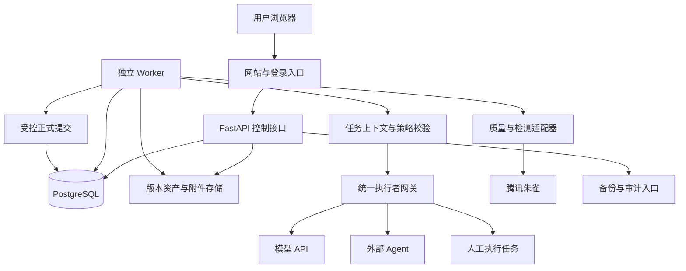

# NovelOS 架构方案

日期：2026-10-23

状态：工程建议；配套约束见[需求规格](requirements.md)。

## 1. 总体结构

采用模块化单体业务后端、独立后台 Worker 和持久数据库。先完成单服务器可靠运行，再根据实测瓶颈扩展，不将微服务或独立消息中间件作为首版前提。



浏览器发起任务后立即取得任务 ID，通过事件流或轮询查询进度。长任务不绑定 HTTP 请求寿命，不以增加代理超时作为恢复机制。

API 与 Worker 共享领域模型和服务边界，通过数据库任务表协调。数据库任务领取采用短事务与行锁；PostgreSQL 提供 `FOR UPDATE SKIP LOCKED`，可用于跳过其他 Worker 已锁定的候选行，但租约、幂等、重试及权限仍由平台实现。[PostgreSQL 文档](https://www.postgresql.org/docs/current/sql-select.html)

## 2. 技术基线与演进

| 层 | 初始建议 | 实施约束 |
| --- | --- | --- |
| 网站 | 延续 Next.js、React、TypeScript | 先评估现有页面复用；实施时核对受支持版本与依赖，建立锁文件 |
| 控制接口 | 延续 FastAPI、SQLAlchemy | 拆分领域服务、外部调用和事务；API 契约版本化 |
| 持久存储 | PostgreSQL 作为新服务器版本主库 | 旧 SQLite 使用受控导入迁移，不直接在原库试验结构升级 |
| 后台执行 | 同一代码库的独立 Worker 进程 | 数据库持久任务队列；不依赖 Web 进程内临时任务 |
| 数据迁移 | 采用有版本号、可演练的迁移工具 | 工具具体版本在阶段 M1 决策；禁止用生产启动时不受控改表代替升级流程 |
| 附件与导出 | 单服务器文件存储适配器 | 内容寻址、原子写入、校验和；以后可适配对象存储 |
| 检索 | 先做结构化检索、中文检索及可选向量召回 | 索引是派生数据；中文分词和召回效果须用样本验证，不能直接假定数据库默认分词足够 |
| 部署 | Docker Compose，HTTPS 反向代理 | 对外只开放网站入口；数据库与 Worker 不暴露公网 |

SQLAlchemy 提供 PostgreSQL 方言，但旧 SQLite 专用 SQL、全文索引、迁移语句和类型差异仍需逐项迁移。[SQLAlchemy 文档](https://docs.sqlalchemy.org/en/20/dialects/postgresql.html)

确有性能或并发需求后再评估 Redis、独立向量库及专用工作流引擎。更换底层队列不得改变任务与成果协议、审计及恢复语义。

## 3. 领域模块

| 模块 | 负责 | 不跨越的边界 |
| --- | --- | --- |
| workspace | 作品、卷章、原稿、附件、版本、导入导出 | 不直接调模型 |
| memory | 人物状态、事实、世界规则、事件、时间线、伏笔、承诺 | 候选与 CANON 分离；维护历史视图 |
| context | 检索、摘要、任务上下文、引用和 token 分配 | 派生摘要不能取代正式原文 |
| planning | 全书、卷章场景规划及依赖 | 重大方向调整形成提案 |
| execution | 执行者注册、能力、适配器、路由、调用记录 | 不授予执行者正式写入权限 |
| workflow | 持久任务、步骤、检查点、重试、取消与恢复 | 不直接决定文学正确性 |
| policy | 权限、审批、预算预留、自动运行规则 | 校验发生在操作执行端，不能只依靠提示词 |
| quality | 一致性、文学与文本特征、文风、检测、门禁、修订 | 检查结果版本化，失败不得伪装成功 |
| inspiration | 灵感收集、分析、采纳与剧情融合 | 未采纳内容不混入正式记忆 |
| learning | 资料、学习成果、创作经验及适用范围 | 参考知识与故事事实分开 |
| changes | 影响分析、失效传播、修复任务与恢复 | 区分明确依赖与语义疑似影响 |
| operations | 登录、凭证、审计、日志、备份与健康检查 | 不将密钥、正文或完整上下文写入普通运行日志 |

建议逐步组织为 `backend/app/domains/<module>/`、`backend/app/adapters/`、`backend/app/worker/` 与 `backend/app/api/`。前端围绕作品、创作台、任务中心、记忆、质量、资料、审批和设置组织。先抽离边界与兼容入口，再迁移调用；目录搬迁本身不作为完成业务能力的依据。

## 4. 持久对象

| 领域 | 核心对象 |
| --- | --- |
| 作品资产 | Work、Volume、Chapter、Scene、Artifact、ArtifactRevision、Attachment、ExportManifest |
| 正式记忆 | Entity、FactProposal、CanonFactRevision、CharacterState、StoryEvent、TimelineInterval、Foreshadowing、Commitment |
| 执行上下文 | ContextSnapshot、ContextReference、RetrievalRun、SummaryRevision、IndexManifest |
| 执行者 | Executor、ExecutorCapability、CredentialReference、Invocation、InvocationUsage |
| 任务 | WorkflowRun、Task、TaskDependency、TaskAttempt、Checkpoint、ResultCandidate、TaskEvent |
| 策略 | PolicyRevision、PermissionGrant、DecisionRequest、Approval、Budget、BudgetReservation、UsageLedger |
| 质量 | StyleProfileRevision、ReviewReport、QualityIssue、DetectionReport、DetectionChunk、GateEvaluation、RevisionAttempt |
| 学习与变化 | Inspiration、SourceMaterial、LearningArtifact、ExperienceRule、DependencyEdge、ChangeProposal、ImpactReport、RepairTask |
| 运行维护 | UserSession、AgentCredential、AuditEvent、BackupManifest、MigrationRun |

所有领域对象包含作品范围、稳定 ID、创建时间和来源。可变资产使用乐观版本号，正文使用不可变版本和内容哈希。审计链记录操作者、父任务、执行者、输入输出及规则版本；不记录模型私有思维过程。

数据库是状态与版本的权威来源；Markdown/TXT 是导出和互操作副本。正文版本首版保存在数据库，附件通过受控存储适配器保存，避免两个可独立编辑的“正式正文”源。

数据库与文件系统不能视为同一事务：先写入暂存附件、计算校验和，再提交数据库引用；事务提交后由持久 outbox 完成导出和索引更新。未引用暂存对象按保留策略清理，引用缺失对象显示错误并阻断相关操作。导出或索引失败可以重试，不能把候选状态误标成未审计的正式修改。

## 5. 统一执行协议

### 5.1 执行者能力

注册时声明支持的任务类型、输入输出结构、上下文上限、工具调用、结构化输出、流式输出、异步回报、取消、用量统计、费用配置和数据外发范围。能力值可为未知；用户配置与探测结果分别记录，不伪造能力。

执行者种类包括模型 API、外部 Agent 和人工。API 通过平台适配器请求；Agent 通过授权任务接口领取或接收任务；人工任务在网站上提交成果。三者共享任务与成果契约，生命周期和传输实现可以不同。

### 5.2 TaskEnvelope

任务输入至少包含：

```text
protocol_version, task_id, attempt_id, task_type, work_id
objective, input_artifact_revisions, context_snapshot_id
constraints, allowed_tools, output_schema_version
deadline, max_output_tokens, budget_reservation_id
idempotency_key, permission_scope, correlation_id
```

Agent 领取模式还包含租约凭证与 attempt fencing token。提供者只收到完成任务所需的预算提示，不获得账户凭证或完整账本。

### 5.3 ResultEnvelope

```text
protocol_version, task_id, attempt_id, submission_id
executor_id, provider, model, finish_reason
result_status, output_artifacts, evidence, warnings
usage, estimated_or_actual_cost, checkpoint_reference
error_code, retryable, provider_request_id
```

平台验证协议、作品范围、成果 schema、完成标志、引用存在性、输入版本与授权；通过后保存候选成果。输出被截断、部分章节缺失或返回半个 JSON 时，标记部分成果或失败，不将其视为成功正文。

错误类型至少区分鉴权、限流、暂时网络故障、超时、输出截断、结构无效、权限不足、输入过期、预算不足和未知结算。只对允许的暂时故障按上限退避重试。执行者切换需要重新校验权限、数据范围、能力与费用，记录原因，不切换到未经用户允许的数据接收方。

### 5.4 初始 API 范围

- `/api/v1/works`、`artifacts`、`revisions`：作品与版本资产。
- `/api/v1/tasks`、`runs`、`events`、`checkpoints`：提交、进度、暂停、取消和恢复。
- `/api/v1/executors`、`agent-tasks`：能力、领取、心跳、候选结果上报。
- `/api/v1/memory`、`proposals`、`changes`：正式记忆、提案与影响。
- `/api/v1/decisions`、`policies`、`budgets`：审批与执行控制。
- `/api/v1/reviews`、`detections`、`gates`、`finalizations`：审查、检测与受控定稿。
- `/api/v1/materials`、`inspirations`、`learning`、`exports`、`backups`：资料与运行维护。

实施时以 OpenAPI 和 schema 为准；本列表是领域契约范围。旧接口经兼容层过渡，禁止仅换路由名却继续开放绕过门禁的旧写入口。

## 6. 持久任务与恢复

任务状态：`QUEUED → RUNNING → SUCCEEDED`；支持 `RETRY_WAIT`、`WAITING_USER`、`WAITING_BUDGET`、`PAUSED`、`FAILED`、`CANCEL_REQUESTED`、`CANCELLED`。审批拒绝与永久失败有独立原因码。依赖循环在入队前拒绝，失败依赖阻断后续任务。

一次尝试的执行顺序：

1. 短事务领取任务，校验依赖与策略，预留预算，生成 attempt 和租约，随即提交。
2. 在事务外构造上下文并调用外部执行者，不在长网络请求期间持有数据库行锁。
3. 定期心跳，保存可恢复步骤和部分成果；流式文本可以留作候选，不能直接覆盖正文。
4. 结果到达时核对 attempt、租约代次、取消状态、输入版本及提交 ID；重复回调返回已有结果。
5. 短事务登记候选成果、费用结算、检查点、任务状态及 outbox 事件。

本地任务投递按至少一次处理，正式成果提交通过幂等实现单次生效。不承诺外部提供者只执行一次或只收费一次。

Worker 失联后租约到期，由恢复进程判断：有可靠提供者请求 ID 时优先查询状态；无法确认调用是否成功时记录在途或未知费用，再按策略决定人工确认或重试。旧 Worker 恢复后不能用过期 fencing token 提交。

暂停停止领取后续步骤，当前调用是否可停依赖提供者能力；取消是请求，外部调用可能仍产生费用。取消后的迟到结果保存在隔离候选记录中，不触发正式提交或后续任务。

检查点保存逻辑步骤、输入版本、上下文引用、已完成候选和费用，不保存提供者内部隐状态。换模型后从可验证步骤重新开始，必要时重跑该步骤，不假定能接续模型内部生成状态。

## 7. 预算、路由与权限

路由先做硬筛选：任务能力、权限、上下文容量、资料可外发范围、用户允许名单、可用性和剩余预算；再根据用户优先级选择成本、质量配置或延迟较合适的执行者。每次保留筛选结果与选择理由。

金额与 token 分开记账，不同币种不隐式相加。调用前按输入估算与最大输出预留费用；并发任务争用同一预算行时通过事务避免超分配。费用未知的执行者只能在用户设置的保守预留规则下自动调用。

结算按调用唯一键去重，记录实际、估计、未知三类状态。超时不自动释放全部预留；核实后再调整。总预算包括初稿、研究、审查、嵌入、检测、重试和重写，不只统计生成正文。

用户会话和 Agent 凭证分开。密钥仅服务端持有，数据库内凭证加密，解密主密钥通过部署环境管理。用户可以限定哪些资料允许发送给哪些提供者。自定义端点及工具请求限制目标地址与重定向，防止未经授权访问服务器内网；本地模型访问通过显式允许规则配置。

## 8. 正式提交与回滚

候选正文、审查报告、检测、审批和候选记忆均绑定确切版本。定稿事务按以下顺序执行：

1. 锁定目标资产并核对当前版本、相关 CANON／文风／策略版本。
2. 复核全部必要门禁和审批；任何报告过期则中止并安排重检。
3. 将该版本设置为当前定稿；提交已获授权的关联正式记忆变更；不能忽略必需的待审批候选。
4. 记录依赖、审计事件及 outbox，提交事务。

仅提出建议的抽取项可保持候选，是否影响定稿由显式规则决定；涉及本章事实正确性且未解决的关键候选属于阻断项。前序章节改变后，依赖其状态的后续章任务和报告标记过期。

回滚采用恢复操作创建新版本，并生成正式记忆的逆向或替代变更；不删除旧版本和审计。回滚后的现行正文、正式状态及导出指针必须一致。恢复旧稿为新的当前定稿仍须满足当前适用门禁；没有有效检测时只能恢复成草稿并安排复检。回滚不能退回已经消费的外部费用。

## 9. 上下文、文风与学习

上下文包含任务目标、已确认设定、目标故事时点的人物状态、相关正文及摘要、未回收伏笔、规划、文风要求和已采纳经验。候选材料仅在任务显式要求时以“未生效”标识提供。按优先级分配 token，不静默丢失核心设定；必需内容无法容纳时缩小任务或请求处理。

每份快照保留检索条件、证据版本、包含与排除清单以及截断理由。摘要保留来源版本；来源改变后失效。向量和索引可重建，分批读取，避免全书正文或全部向量长期一次装入请求内存。

文风档案由样本、可解释指标、叙述目标与可审核规则组成，按书、人物、视角和故事阶段限定范围。有意创新作为版本化例外，不将单次偏离永久推广为规则。

学习成果保存来源、结论、证据、适用范围、置信度和采纳状态。用户通过资料学习得到的是平台可携带知识与规则，不默认触发模型训练。经验规则先成为候选，经用户或明确规则授权后启用，跟踪复发率和改进效果，可撤销。

## 10. 检测与有界修订

检测适配器提供能力说明、请求限制、规范化结果、原始结果和计量映射。朱雀字段与通过条件严格按需求规格执行，开发桩只用于测试。

长章请求生成覆盖清单，保留原文偏移、哈希、分块版本和重叠信息；校验全部正文被覆盖且每块通过。保存精确检测文本，禁止在检测前静默删除风险段落。正文、检测策略或必要的分块策略改变时重新检测。

每轮修订先产出独立候选，再评估是否解决问题和是否引入剧情、文风或文学质量退步。质量倒退、连续无进展、费用或次数触顶时停机待决。局部修订也要重新校验相关的章级及跨章门禁。

已有效的报告可以缓存，键至少包含正文哈希、提供者、模型版本可知值、请求参数、检测策略版本与有效期。提供者模型版本未知时不声称永久有效，按时效策略安排重检。免费额度按实际用量字段与提供者控制台对账，未知用量保守预留。

## 11. 服务器运行与备份

最小部署包含 HTTPS 入口、网站、API、Worker、PostgreSQL 和受控附件卷。API 服务只处理控制请求；长任务由 Worker 执行；生产界面不依赖浏览器保持在线。

首版为单用户登录，首次部署通过本地初始化命令创建账户，不提供开放注册。生产强制凭证配置，受保护会话、登录限速、CSRF／来源校验、上传大小和类型限制均纳入验收。公开健康接口不泄露私有配置。

结构化日志以任务及关联 ID 为核心；审计保存必要资产引用与受控响应，普通运行日志对密钥、正文、上下文和错误响应脱敏。持久成果与审计按保留策略保存，临时流和中间缓存可有界清理。

备份清单包含数据库快照、已引用附件、格式版本、部署兼容信息和校验和；加密凭证恢复所需的主密钥单独安全备份。为保证数据库与文件一致，先确保新附件先于引用提交，再取得数据库快照并收集快照内引用对象；在备份期间禁止清理这些对象。恢复后验证引用、资产哈希、正式状态和任务租约，先保持自动执行暂停，再由用户恢复。

升级先备份、运行迁移预检、停止任务领取并处置在途任务，执行版本化迁移与冒烟，再恢复调度。应用回退是否兼容新数据库结构必须由演练结果决定，不能只回退容器标签。

## 12. 需要记录的工程决策

M1 建立 ADR 记录数据库与迁移方案、登录与密钥方案、文件一致性策略、任务幂等和目录边界。后续记录中文检索选型、首批执行者、朱雀请求限制与分块语义、成本估算规则及备份方式。每份记录说明理由、替代方案、影响和验证方式；技术调整不自动改变产品需求。
